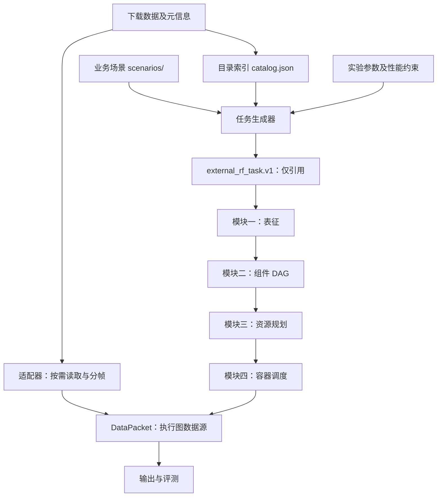

# 数据驱动的射频任务输入

这里分别管理数据记录、业务场景和任务构造。生成器输出现有模块一接受的 `external_rf_task.v1`，不读取七个合成示例作为真实任务，不向输入 JSON 写入内部 S/Q/R/G/X。



任务可生成、适配器可读、组件链可执行、画像覆盖、结果可评分是不同状态。索引 `ready` 只表示适配器可读；生成结果还会报告组件匹配状态，提交时模块三继续核对容量、时限和画像。

## 本机数据

2026-11-13 索引了 9 个源文件（含压缩包、标签和波门），信号引用共 565 条：

| 数据 | 本地核对 | 当前范围 |
| --- | --- | --- |
| ADS-B SigMF | ci16_le、8 Msps、1090 MHz、1.6 亿复样点约 20 秒，声明 SHA512 已核对 | 按窗读取 IQ；频谱场景实际跑通 3 帧 |
| ATCO2 tgz | 560 条 PCM WAV 及 XML/INFO 引用 | 不解压读取音频，生成语音业务；ASR 链未实现 |
| Iridium PLUTO1 MAT | 63,407 条独立突发，QPSK/BPSK/pilot 字段及 66 类标签映射 | HDF5 切片，QPSK 频谱场景实际跑通；身份分类模型未接入 |
| data1 雷达 MAT | radar_pulse_squence 为 319×64000，附波门及目标真值 | 可生成搜索任务；距离×脉冲矩阵的执行适配及对应链未接入 |

Iridium 三组字段属于同一批观测，不能算作三倍独立突发或拼成连续采样流。参考标签只在评测侧读取，不写进组件输入 metadata。

来源见 [sources.json](sources.json)。用户提供的 [Iridium DOI](https://doi.org/10.5281/zenodo.21926940) 与本地变量相符；布局、标签和参数参考 [作者论文](https://www.mdpi.com/1424-8220/26/20/6418)。按论文登记 960 ksample/s、采集中心频率 1626.25 MHz，并保留“已预处理突发”性质，不称为连续原始 RF。

雷达来源为 [ScienceDB](https://www.scidb.cn/en/detail?dataSetId=720626420979597312)，参数参考 [原始论文](https://doi.org/10.11922/csdata.2019.0075.zh)：35 GHz、PRF 32 kHz、距离单元间隔 1.875 m。PRF 不填入 ADC 采样率；该记录不宣称来自 E-3。场景的分辨率和重访要求独立配置。ADS-B、ATCO2 下载 URL 和许可尚待补齐，没有由文件名编造来源。

## 文件职责

```text
catalog.json       文件哈希、记录索引、可读状态
sources.json       下载来源、许可、核对说明
catalog.py         相对路径、记录及场景查询
inventory.py       源文件、压缩包及 MAT 顶层变量索引
generator.py       场景＋记录＋参数 → 外部任务
execution.py       懒加载帧序列、DAG 数据源绑定、诊断
adapters/          SigMF、WAV、Iridium、雷达描述引用
scenarios/         独立业务场景，不是模块一内部模板
requirements.txt   可选 MAT/HDF5 依赖
```

已有原始文件全部保留在原路径；散放的信号、压缩包、MAT、WAV 等已加入 Git 忽略。Git 保留代码、来源及约 0.8 MB 的描述索引，不上传数 GB 原始数据。以后下载仍建议放对应业务的 `raw/<dataset_id>/<version>/`，说明放 metadata，背景文献放 references，转换产物放 interim/processed。原三类目录保留，根 scenarios 作为统一场景入口。

## 生成与执行

在项目目录执行。SigMF/WAV 使用现有依赖；MAT 检查和 Iridium 读取另需可选依赖：

```powershell
.\.venv\Scripts\python.exe -m pip install -r datasets/requirements.txt
.\.venv\Scripts\python.exe -m datasets scan --hash
.\.venv\Scripts\python.exe -m datasets list
.\.venv\Scripts\python.exe -m datasets generate --scenario adsb_spectrum --record record-3d6096f97185cd5e --output outputs/adsb-dataset-task.json
.\.venv\Scripts\python.exe -m datasets validate --task outputs/adsb-dataset-task.json
```

`scan --hash` 流式计算 SHA256/SHA512 并核对 SigMF 声明值，不解压、重采样或重命名。普通 scan 在大小/修改时间相同时复用已有哈希。首次无哈希记录不能生成任务，文件变化后须重新核对。`verify --record <ID>` 可再次校验整个源文件 SHA256。API 路径限定在数据根内。

输出任务 JSON 可直接上传给模块一，同时输出 `.binding.json` 说明。默认 task_id 根据源版本、场景和参数确定；并发实验可显式使用不同 task_id。

用 `--experiment <JSON文件>` 指定窗口等参数，例如：

```json
{"sample_start":0,"frame_length":4096,"frame_count":3,"priority":6,"deadline_after_ms":1000}
```

采样率和中心频率来自记录，不能任意覆盖。窗口、FFT、抽取、频移、滤波、时限必须满足数据范围及规格；新参数可能需要新增画像。默认频移 100 kHz、抽取 2、截止 0.25、FFT 1024 是明确的场景选择，不是 ADS-B 接收机解码规范。

```powershell
.\.venv\Scripts\python.exe -m datasets run --scenario adsb_spectrum --record record-3d6096f97185cd5e --deployment examples/ResourceSimulations/heterogeneous_simulation.json --output outputs/adsb-dataset-run.json
.\.venv\Scripts\python.exe -m datasets run --scenario iridium_spectrum --record record-239ab02d466b4678 --deployment examples/ResourceSimulations/heterogeneous_simulation.json --output outputs/iridium-dataset-run.json
```

这两份报告使用下载的真实信号、真实 Python 计算；DSP/FPGA 容量和耗时仍来自软件模型，不能称为真实硬件基准。诊断包含输出大小、有限值和功率；不伪造报文正确率、ASR 字错率、卫星分类准确率或检测概率。需要配套解码器/训练模型及标签对齐后才能评分。

适配器每次读取一帧。整数 IQ 转相对满量程，不声称电压标定；SigMF 跨 capture 窗口会拒绝，频率不跨段继承，支持纳秒 UTC 文本。Iridium 只切字段及 observation，不遍历庞大内部字符串树；独立突发不串接。WAV 不伪装成 RF IQ，雷达不进入原始 IQ 的 LFM 示例链。读帧前后复核源文件大小和修改时间。

`atco_audio_review`、`iridium_identification`、`radar_search` 可生成外部任务和业务图，但当前明确返回 `MISSING_CAPABILITY`，分别缺少语音识别、卫星身份分类或雷达矩阵目标检测能力，没有被算成可执行链。现有七个合成 JSON 仍只用于接口测试。频谱场景不再填写预设 `profile`，模块二根据功能需求及数据契约装配，详见[模块二说明](../docs/module2_demand_composition.md)。

## API 与前端

- `GET /api/v1/datasets`：本机索引。
- `GET /api/v1/datasets/scenarios`：场景定义。
- `POST /api/v1/datasets/tasks`：`{scenario_id,record_id,experiment?}`，返回任务及组件就绪状态。
- `POST /api/v1/datasets/executions`：`{task,keep_warm?}`，复用原异步管理器；样本不经浏览器上传。
- 原 `/api/v1/task-representations/external` 不改协议，也不访问数据文件。

`MRF_DATASET_ROOT` 可指定包含 catalog/scenarios 的其他本地根。任务页新增生成器：选场景、记录、窗口与时限，点“生成任务并载入模块一”，匹配和规划可行后使用原“提交执行”。进度沿用节点/帧事件；并发任务 ID 各自独立，受控引用相同记录。

重启 API 后新增接口生效，前端开发服务会更新组件。资源仿真启动命令仍为 `.\deployment\start_simulation_api.ps1 -Port 8011`。运行 `python -m unittest tests.test_dataset_generator -q` 验证哈希、窗口、时间戳、音频隔离、突发不串接、标签不泄漏、路径检查及异步执行。
