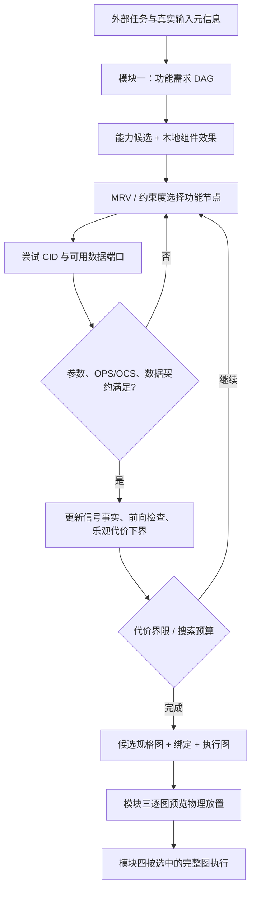

# 模块二：需求驱动组件 DAG 装配

模块一提取功能需求及依赖；模块二依据能力、参数、OPS/OCS 匹配组件并连接成图；模块三选择 CPU、C66x 核心或 FPGA 区域；模块四取得实例并执行。同一功能可以匹配多个 CID，DSP/FPGA 实现版本仍由模块三选择。



## 输入

新频谱任务不需要 `processing.profile`。`fft_length`、`overlap` 等算法参数仍需明确；指定抽取、频移或滤波参数时会将相应功能作为需求保留。已有数据满足契约时不会因为任务名称而强制加入 DDC/FIR。

也可以在外部任务的 `request` 中直接声明功能图。以下是功能需求，不包含 CID：

```json
{
  "functional_dag": {
    "nodes": [
      {"id": "left", "capability": "fir_filter", "parameters": {"coefficients": [1]}},
      {"id": "right", "capability": "fir_filter", "parameters": {"coefficients": [2]}},
      {"id": "join", "capability": "iq_branch_merge", "output_format": "iq/complex",
       "parameters": {"gain_left": 1, "gain_right": 1}}
    ],
    "edges": [
      {"source": "left", "target": "join", "target_port": "left"},
      {"source": "right", "target": "join", "target_port": "right"}
    ]
  }
}
```

多前驱、多输入节点要指定 `target_port`，避免交换端口导致语义错误。声明了命名依赖时，各端口仅消费对应前驱分支的数据；未声明依赖的输入端口从外部输入供给。当前一个任务绑定一个外部逻辑输入；它可以扇出给多个分支。多个独立数据源和自动转换参数搜索尚未实现。`expected_output` 可用已有语义名（如 `spectrum_psd`），或明确的 OPS 格式名（如 `iq/complex`）；未知输出不会被随意标记为覆盖。

## 搜索范围与结果含义

`matching/composition/operators.json` 只存组件本地效果和参数别名，不存业务名称对应的完整链。自动插入转换目前只开放 C03；每个功能前沿对相同转换应用一次，更复杂的多级转换需显式声明功能及参数。其他已注册能力可在功能图中直接选用；未知形状变化不推测。

B&B 当前优化**已声明非负算子代价之和**，默认每个组件为 1，即偏好较少组件。它不是基于虚构的精度、可靠性或耗时画像作加权优化。结果中的 `cost_basis`、`optimality_scope` 和 `qos_verified=false` 明确这个范围。后续有标定数据后再加入可信的性能目标；当前模块三仍检查物理容量、链路预算与按执行器串行语义估计的截止时间。

搜索按可行候选数与约束度选择需求节点，复用静态参数及端口校验，缓存候选和边兼容检查，并按乐观下界剪枝。默认最多保留 4 个候选图，最多访问 10000 个状态、24 个组件、2000 ms。可通过 Python `match_task(..., composition_limits={...})` 调整后三项。达到预算时报告 `SEARCH_LIMIT` / `FEASIBLE_SEARCH_LIMIT`，不声称无解或最优。`optimality_proven` 仅针对声明的结构代价及算子/参数范围，不代表全局硬件最优。

模块三逐一预览这些候选图。规格图、CID 绑定、执行图、外部源映射作为一个整体选择，响应 `selected_match` 对应最终分配图。若有限候选都无法放置，仍不能推断全部可能组合都无解。

新仿真图的链路预算由配置 `transfer_policy` 显式给出格式字节宽度与预留带宽，并按节点输出块长度计算每次调用字节数，不依赖旧节点名称。缺少长度或格式宽度仍返回 `NEEDS_TRANSFER_PROFILE`；该预算属于仿真配置，不能视为真实链路测量。

## 兼容与诊断

- 已有显式配置的 OFDM 等协议演示保留兼容入口，逻辑移入 `matching/legacy_refinement.py`；`task_repr/template/refinement.py` 仅保留规格类型和兼容调用。它们不是新功能图的生成前提。
- `MISSING_CAPABILITY`：组件库没有该能力，例如语音识别、卫星身份分类。
- `NEEDS_PARAMETERS`：缺少参数、端口约束或存在错误需求。
- `INFEASIBLE`：声明范围搜索完成但没有兼容组件图，包括无法覆盖目标输出。
- `SEARCH_LIMIT`：预算内还未找到图；不能视为无解。

前端“规格 DAG / 组件执行图”展示生成结果，并显示搜索状态和结构代价。验证入口：

```powershell
.\.venv\Scripts\python.exe -m unittest tests.test_demand_composition tests.test_business_static_match -v
```
